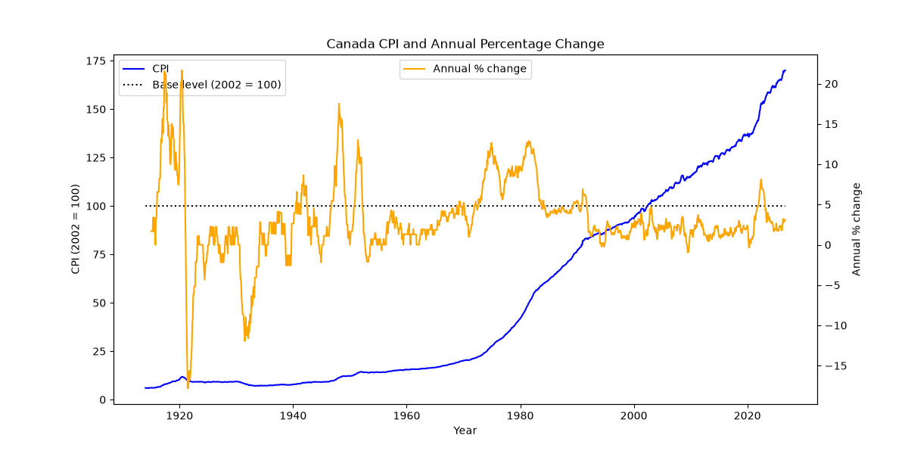

# FINE3300-2026-A2

### Description
- FINE 3300, Fall 2026, Assignment 2
- I made a CPI graph and an inflation calculator in Python, based on the [Bank of Canada Inflation Calculator](https://www.bankofcanada.ca/rates/related/inflation-calculator/).
- The Bank of Canada calculator only lets you pick a year. Mine lets you pick a month and a year.

### Files
- `CPIGraph.py` - makes the graph of the CPI and the annual % change, and saves it as `CPI_Graph.png`
- `InflationCalculator.py` - the inflation calculator
- `STATIC_INFLATIONCALC.csv` - the CPI data from the Bank of Canada
- `CPI_Graph.png` - the graph

### How to use it
1. Install pandas and matplotlib if you don't have them:
   ```
   pip install pandas matplotlib
   ```
2. Download all the files and put them in the same folder.
3. Open that folder in VS Code (File → Open Folder).
4. Run `CPIGraph.py` to see the graph.
5. Run `InflationCalculator.py` to use the calculator. It will ask you for:
   - the price (just the number, e.g. `1000`)
   - the first date (e.g. `1995-07`)
   - the second date (e.g. `2026-09`)

If you type something wrong, it tells you and asks again.

Example:
```
Enter the price: abc
Invalid price. Enter a positive number, e.g. 100 or 2500.50
Enter the price: 1000
Enter the first date (YYYY-MM): 1800-01
Invalid date. Use YYYY-MM between 1914-01 and 2026-09
Enter the first date (YYYY-MM): 1995-07
Enter the second date (YYYY-MM): 2026-09
```

### CPI Graph



**Commentary:**
<!-- Check these against YOUR graph and put them in your own words. -->
The CPI (blue line) goes up slowly until around 1970, then rises a lot faster. The dotted line is the base level of 100, which is the CPI in 2002.

Some interesting parts of the annual % change (orange line):
- Around 1917–1920 (WWI), inflation spiked, then prices dropped in the early 1920s.
- In the early 1930s (Great Depression), prices went down, so the line goes below 0%.
- In the 1970s and early 1980s, inflation was really high, over 10% at times.
- Since the 1990s, inflation has mostly stayed around 2%, which is the Bank of Canada's target.
- In 2021–2022, after COVID, inflation jumped up again.

### Sample Output
<!-- Replace this with a real run from your own program. -->
```
--------------------------------------------------
$1,000.00 CAD in 1995-07 would cost $X,XXX.XX CAD in 2026-09
Percent change: XX.XX%
Number of years: 31.17
Average annual rate of inflation: X.XX%
CPI for 1995-07: XX.X
CPI for 2026-09: XXX.X
2002 CPI = 100.0
--------------------------------------------------
```

### Data Source
Bank of Canada: https://www.bankofcanada.ca/valet/observations/STATIC_INFLATIONCALC/csv